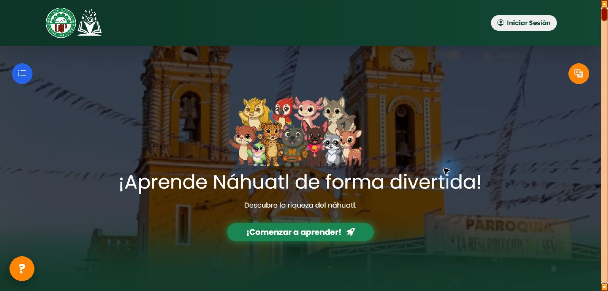

# Castores Multilingües Aul@Net



**Aul@Net** es una plataforma educativa para aprender y difundir el náhuatl de La Resurrección, Puebla. El sitio combina lecciones interactivas, cuentos, cultura comunitaria y seguimiento del avance.

## Qué incluye

- Página pública de presentación y registro.
- Lecciones y actividades de vocabulario en náhuatl.
- Secciones de cuentos y cultura.
- Perfiles, progreso, puntajes, rachas y medallas.
- Interfaz Español/Náhuatl.
- Formularios y endpoints PHP que conectan con MySQL.

## Tecnologías

- PHP y PDO para endpoints y conexión a MySQL.
- HTML, CSS y JavaScript.
- Bootstrap y Bootstrap Icons.
- Chart.js para visualizaciones.

## Estructura del proyecto

| Ruta | Contenido |
|---|---|
| `pages_ext/` | Presentación pública, inicio de sesión y registro. |
| `pages_int/` | Inicio y módulos de aprendizaje para usuarios. |
| `php/` | Endpoints, procesos y plantillas de configuración de base de datos. |
| `js/` | Interacciones, traducción, progreso y lógica del sitio. |
| `styles/` | Hojas de estilo de las páginas. |
| `assets/` | Bootstrap, iconos, gráficos y bibliotecas locales. |
| `Recursos/` | Imágenes, mapas, ilustraciones y material educativo. |
| `json/` | Datos usados por actividades y módulos. |

## Ejecutar en WSL

Desde la raíz del proyecto en Ubuntu/WSL:

```bash
php -S 0.0.0.0:8000 -t .
```

Abre `http://localhost:8000/pages_ext/index.html` en el navegador. El servidor integrado de PHP sirve el sitio para desarrollo local; no es un servidor de producción.

## Conexión a MySQL y configuración sensible

`php/conexion.php` contiene configuración local y **no se versiona**. El archivo se conserva en el checkout local, pero se excluyó del índice de Git. Para preparar una instalación nueva:

1. Copia `php/conexion.example.php` como `php/conexion.php`.
2. Define `AULANET_DB_HOST`, `AULANET_DB_NAME`, `AULANET_DB_USER` y `AULANET_DB_PASSWORD` en el entorno WSL.
3. Inicia el servidor PHP desde esa misma terminal para que herede las variables.
4. Mantén los valores reales fuera del repositorio. No subas respaldos SQL con datos reales, archivos `.env`, llaves privadas ni documentos con datos personales.

La plantilla no incluye contraseñas ni abre conexión hasta que se configuren las variables. Ajusta el nombre de la base de datos y el usuario según tu entorno local.

## Equipo desarrollador

Los nombres y descripciones siguientes se toman de la sección pública del sitio:

- **Julio Cesar Trinidad Garcia** — líder de proyecto y desarrollador Full Stack; coordinación, arquitectura e integración tecnológica.
- **Marco Antonio Cortés Rojas** — desarrollador y tester; pruebas y aseguramiento de calidad.
- **María Guadalupe Ortiz Gómez** — desarrolladora y analista; análisis de requerimientos y soluciones digitales.
- **Luz Adriana Pérez Romero** — desarrollo de plataforma y gestión de base de datos.
- **Rodolfo Abraham Cortés Ramos** — diseño UI/UX e interfaces.

## Contexto institucional

El sitio presenta Aul@Net como un proyecto educativo desarrollado por estudiantes de la **Universidad Tecnológica de Puebla**, con enfoque en preservar, enseñar y difundir la variante náhuatl de La Resurrección. La información pública del proyecto identifica a Puebla, México, como su comunidad de referencia.

## Seguridad de Git

El `.gitignore` excluye configuración local, respaldos y volcados de bases de datos, llaves privadas, registros y carpetas para documentos sensibles. `.gitignore` no elimina archivos que ya estaban en el historial: `php/conexion.php` fue retirado del índice actual, pero su historial anterior puede seguir conteniendo credenciales. **Rota la contraseña de base de datos** y, si el repositorio remoto contiene esos commits, coordina la limpieza del historial con quienes colaboran antes de volver a publicar. No reutilices la contraseña anterior.

La captura de portada es una referencia visual del sitio público; el contenido puede cambiar con futuras versiones.